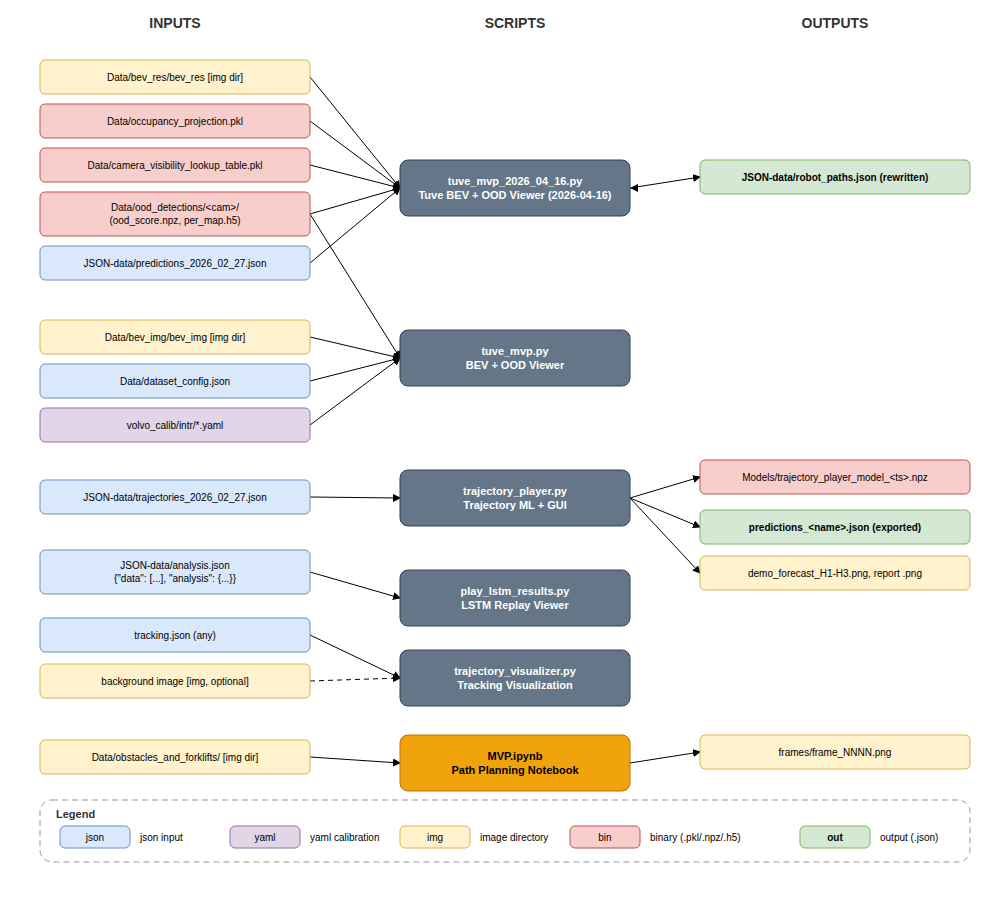

# How to populate the `Data` directory

- **Volvo Tuve dataset**: - `WP6 - PrototypesDemonstrators (Volvo)\datasets\(CONFIDENTIAL)` 
- **Anomaly detections (Jesper)**: `WP6 - PrototypesDemonstrators (Volvo)\datasets\ood_detections`
- **Trajectory from Volvo**. Original codes are at `P119522 - SMILE IV - General\Volvo Trajectories`.
- **Prediction and Classifications**. Original codes are at `P119522 - SMILE IV - General\Joakim`:


# Quick start

Run `tree -L 2` to make sure that all the data files are correctly placed in your `Data`. 

> The location of the dataset is set by `paths.dataset_root` in `mvp-config.json` (default: `Data`). If your data is outside the project, change that value, but **please do not push that change to the repository**.

```
.
├── Data
│   ├── 160 ... 171                      camera frames (one folder per camera)
│   ├── bev_img/bev_img                  BEV masks used by tuve_mvp.py
│   ├── bev_res/bev_res                  BEV masks used by tuve_mvp_2026_04_16.py
│   ├── camera_visibility_lookup_table.pkl
│   ├── dataset_config.json
│   ├── obstacles_and_forklifts          prediction data (forklifts, obstacles)
│   ├── occupancy_projection.pkl
│   ├── volvo_coordinate_mapping.pkl
│   └── ood_detections/<cam>/            per-camera OOD scores and heatmaps
├── JSON-data                            trajectory, prediction and robot-path JSON files
│   ├── trajectories_2026_02_27.json
│   ├── predictions_2026_02_27.json
│   └── robot_paths.json
├── Models                               saved trajectory models (written by trajectory_player.py)
├── MVP.ipynb
├── mvp-config.json
├── play_lstm_results.py
├── README.md
├── requirements.txt
├── tuve_mvp_2026_04_16.py                   Tuve viewer, 2026-04-16 (paths read from mvp-config.json)
├── trajectory_player.py
├── trajectory_statistics.py
├── trajectory_visualizer.py
├── tuve_mvp.py
├── undistorter.py
└── volvo_calib
    ├── extr
    └── intr
```

`Data/`, `JSON-data/` and `Models/` hold large data files and must not be committed. `.gitignore` excludes `*.npz`, `*.pkl`, `*.h5`, `*.png` and the large `JSON-data/trajectories_2026_02_27.json`, but not everything in these folders, so check `git status` before every commit. Camera `168` has no frames in the dataset.

# Local-only model and calibration files

These files are git-ignored and must be copied in separately. They are listed here so you know what they are.

**`Models/`** (saved trajectory models, `.npz`):
- `trajectory_player_model_<timestamp>.npz`: written by `trajectory_player.py` every time it trains (`--demo`, `--gui`). The timestamp is the training time, so each run creates a new file.
- `model_20260416_131406.npz`: produced on 2026-04-16. Its creating script is not recorded.

**`Data/`** (`.pkl` calibration and lookup tables):
- `occupancy_projection.pkl`: camera projection (`P`, `K`, `R`, `t`) used by `tuve_mvp_2026_04_16.py` to project the occupancy map.
- `camera_visibility_lookup_table.pkl`: BEV-to-camera visibility lookup used for OOD scoring (see *OOD scoring* below).
- `volvo_coordinate_mapping.pkl`: not referenced by any script in this repo. Its purpose is not documented.
First create a new virtual environments and install dependencies, you only need to do this step **once**. 
```
python -m venv smile-env
source smile-env/bin/activate
# Activate it on Windows:  smile-env\Scripts\activate # To activate
pip install -r requirements.txt
```
> After doing the previous steps once, you can get into your virtual environment by running `source smile-env/bin/activate`

Run the project:

```
python trajectory_player.py  --gui
```
```
python -m ipykernel install --user --name=smile-env --display-name "Python (SMILE-IV)"

jupyter notebook MVP.ipynb
```

You can open `JSON-data/analysis.json` after running:
```
python play_lstm_results.py
```

```
python tuve_mvp.py
```

Tuve viewer from 2026-04-16 (reads its paths from `mvp-config.json`, run from the repo root):
```
python tuve_mvp_2026_04_16.py
```

# Demo

Two short demo videos show the MVPs in use. Run them from the repo root.

**Trajectory player** (`trajectory_player.py`)

1. Start the viewer with `python trajectory_player.py --gui`.
2. Step through the frames with the controls at the bottom, or drag the *Position* slider.
3. Pick an object with the *Object* selector to see its route probabilities and maneuver (moving, loading, stationary).
4. Adjust the *Maneuvers Tuning* sliders to change how sensitive the maneuver detection is.

[](https://youtu.be/ebqgq2yV7IE)

**Tuve viewer** (`tuve_mvp_2026_04_16.py`)

1. Start the viewer with `python tuve_mvp_2026_04_16.py`.
2. Use the frame slider to move through the recording.
3. Choose the AMR path and the active forklift in the side panel.
4. Read the decision (GO or YIELD), time-to-collision, trust, and camera OOD score for the selected forklift.

[](https://youtu.be/w72y5S-MajQ)



# Updates

## OOD scoring implemented by Erik
Based on the robot's position, the OOD score is pulled from every camera that can see the robot (based on the pre-computed bev-to-camera mapping `camera_visibility_lookup_table.pkl`). To view this in live action run:

```
python tuve_mvp.py --show-ood-viewer --ood-cameras 160-162
```


# Contribute

Before saving and committing your jupyter notebooks, go to the Jupyter menu:
> Kernel -> Restart & Clear All Output.

or initialize nbstripout in your repo to let git doing that automatically
```
nbstripout --install
```


# Issues
if you get the following error message:
```
qt.qpa.plugin: From 6.5.0, xcb-cursor0 or libxcb-cursor0 is needed to load the Qt xcb platform plugin.
qt.qpa.plugin: Could not load the Qt platform plugin "xcb" in "" even though it was found.
```
install:

```
sudo apt install libxcb-cursor0
```
